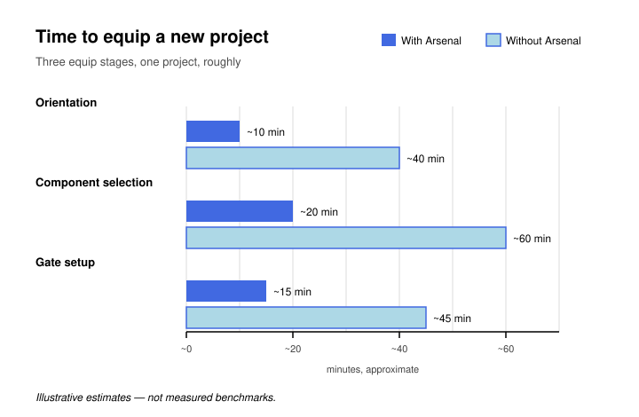
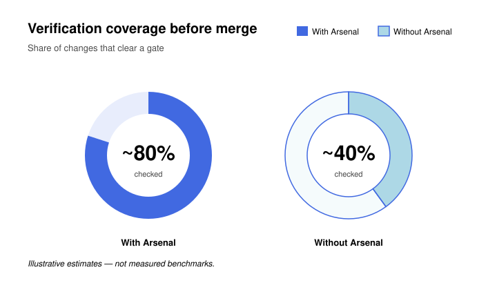
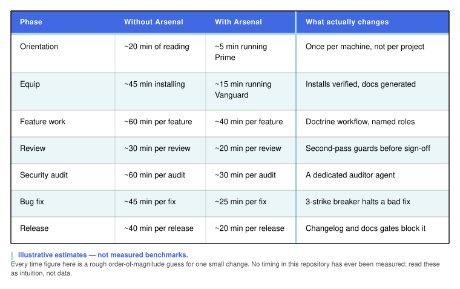
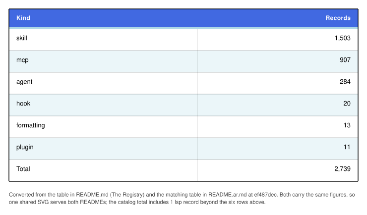
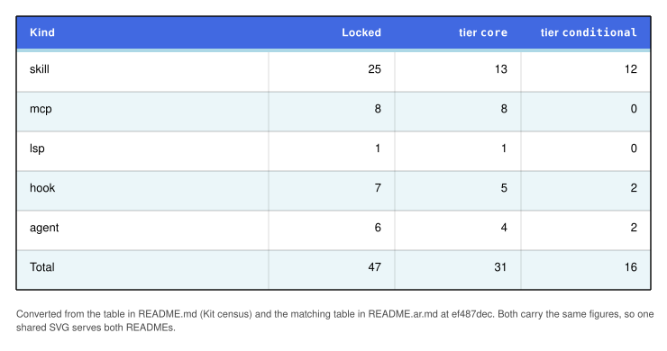
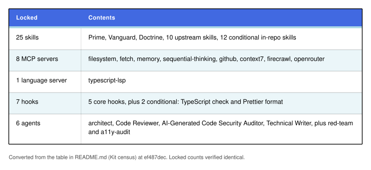

# Vantrilex Arsenal

**Four skills, one registry, one pinned kit.**
**v0.9.30 — Autonomous weekly cycle:** version `v0.9.30` · merge `c520839beb8eae3d104853bc66b60f6430436f4f` · tag `8eabf9fea6061646bf9b33acb547fe98558f1c74` · size `182`.
Slot 0.9.30 carries the Autonomous weekly cycle plus draft-version assembler as data; advisory number only, assigned at close (fallback FBLD-30).
**v0.9.29 — Mission compiler:** version `v0.9.29` · merge `03c077fa117dd1128527c982f7ef92cdc6639a14` · tag `0a385e51654e2148ae8e484b4e1debb225f6b2ed` · size `175`.
Slot 0.9.29 carries the Mission compiler plus planning-quality loop as data; planner proposes placement with reasoning; no slot is the decided home (fallback FBLD-29).

**v0.9.26 — Knowledge packs:** version `v0.9.26` · merge `ddcaf785510847e47ac235cf5e2a0e6cc35f7437` · tag `5f1da7fd9e6699443ef7d04f2c96e88aed05665e` · size `174`.

**v0.9.27 — Eval packs as a category:** version `v0.9.27` · merge `bdeafe416b6c9ee360aca46919e2fd58d64a32ff` · tag `4d8bbd3b1ff86d2fbf8e1fa10fb1a97d5af78884` · size `169`.
LD-27 carries eval packs as a category: tested evaluators, measured difficulty, calibration variance, and an integration-recipe subtype with bilateral links; fallback FBLD-27 lean cite carried, never widened.
Fill rides W7b after publish: `v0.9.27`, `bdeafe416b6c9ee360aca46919e2fd58d64a32ff`, `4d8bbd3b1ff86d2fbf8e1fa10fb1a97d5af78884`, and `169` stay placeholders in this draft with zero 40-hex filled now.

**v0.9.28 — Gap register:** version `v0.9.28` · merge `136371c94ce8426d0863bab0fde4c63a8605ede1` · tag `6eea674c20285a0bf9e499040576882acff27451` · size `171`.
LD-28 carries the gap register as scoped on the version branch; substance rides the build scope, never assumed in this draft.
Fill rides W7b after publish: `v0.9.28`, `136371c94ce8426d0863bab0fde4c63a8605ede1`, `6eea674c20285a0bf9e499040576882acff27451`, and `171` stay placeholders in this draft with zero 40-hex filled now.

**Current release:** `v0.9.25` — LD-25 Guardrail packs (guardrail packs: acceptance + adversarial proof + declared failure mode + recorded override). Merge: `a1d4d3fa2f7485ab8d7818672d67e8a6cb25e247` · Tag: `d0a4f9dacabadddefb6b8a1b80e9eb10778aa68b` · Size: `174`. Lands with or just after publish; scope per `WORKFLOW.md` 0.9.25 block.

Vantrilex Arsenal is a shareable OpenCode plugin plus a component system. It
provisions a target project with a curated, version-pinned kit of skills, MCP
servers, plugins, hooks, agents, and design conventions — then governs how that
kit is used. It is not a bundle of everything; it is an arsenal you equip per
project.

![The six elements of the Arsenal and the role of each: the kit, which is everything that gets provisioned onto a project; Vantrilex Prime, which answers where the Arsenal is and how to pin it; Vantrilex Vanguard, which detects the project, selects and equips the kit, and verifies it works; Vantrilex Workflow-Forge, which authors the per-task workflow before execution begins; Vantrilex Doctrine, which holds the law on roles, gates, workflows, and rituals; and the Vantrilex Registry, a catalog of machine-readable records with honestly labelled install commands](docs/assets/tables/elements-role.svg)

*The table images in this file still render the prior census and are pending regeneration; the prose figures are the live verified counts.*

The repository is Node 25, ESM, and zero dependencies. It contains **no AI or
ML model logic** — only Markdown, JSON, and Node ESM. Nothing here may invent an
install command.


**Visual identity.** The mark, the stencil wordmark, and the nine-icon
family are the Arsenal's identity, specified in
[`brand/IDENTITY.md`](brand/IDENTITY.md) — read it for the concept, the
complete asset list, the palette, and the usage rules. The lockup above is the
static light-ground variant; `brand/logo/arsenal-lockup-dark.svg` is the same
lockup on a dark ground with royal blue inverted to white, and is the correct
file there. **The logo is never animated** — all five files in `brand/logo/`
are static, and every motion in the identity lives in the icon family.


Each of the nine has an animated sibling with the same geometry under
`brand/animated/`.

---

## What the Arsenal is


Two parts, with one boundary between them:

- **A shareable OpenCode plugin** — `.opencode/` ships the plugin, the four
  top-level skills, ten agent files, and four operator commands.
- **A component system** — `registry/` is the catalog the plugin draws from,
  and `.opencode/equip.manifest.json` records the phase selection over that
  catalog which every project receives.

The plugin provisions; it does not decide. Selection lives in the Registry and
`.opencode/equip.manifest.json`, conduct lives in Doctrine, and the plugin only enforces what
those two declare. That is why the kit is *recorded*: a project that
equipped last quarter gets the same components it got last quarter.

---

## The four skills

 **Vantrilex Prime** answers *where the Arsenal is*. It runs once per machine,
not once per project: it states what the Arsenal is, gives the canonical
repository URL, shows how to clone and pin it with `git rev-parse HEAD`, lists
what is on disk, shows how to confirm the four skills exist, fixes the order
Prime → Vanguard → Workflow-Forge → Doctrine runs in, and states the standing laws every later
phase obeys. Orientation only — it does not survey the project, and it does not
define how work is conducted. See
[`.opencode/skills/vantrilex-prime/SKILL.md`](.opencode/skills/vantrilex-prime/SKILL.md).

Install directly:

```text
npx skills add 3mar-baha/vantrilex-arsenal --skill vantrilex-prime
```

 **Vantrilex Vanguard** answers *what does this project need?* It is the EQUIP
phase, run once per target project. It detects one of four project states by
scanning the repository rather than asking, surveys the resources present,
selects and installs the kit with real commands, verifies each component
installs and loads, reports what it equipped, and prepares the 28-file
target-project documentation system. It refuses to hand over a kit it has not
verified. See
[`.opencode/skills/vantrilex-vanguard/SKILL.md`](.opencode/skills/vantrilex-vanguard/SKILL.md).

Install directly:

```text
npx skills add 3mar-baha/vantrilex-arsenal --skill vantrilex-vanguard
```

**Vantrilex Workflow-Forge** answers *how is this task run?* It authors the standing methodology: the workflow for each task, written before execution begins rather than during it. Vanguard installs it in the Step 4 lane and proves the install by read-back — the file exists at `.opencode/skills/vantrilex-workflow-forge/SKILL.md`, its frontmatter `name` equals `vantrilex-workflow-forge`, and `node scripts/verify-skills.mjs` exits 0. Until that proof lands, the skill set is incomplete. See the Forge skill install section of [`.opencode/skills/vantrilex-vanguard/SKILL.md`](.opencode/skills/vantrilex-vanguard/SKILL.md).

Install directly:

```text
npx skills add 3mar-baha/vantrilex-arsenal --skill vantrilex-workflow-forge
```

 **Vantrilex Doctrine** answers *how is the kit used?* It is the WORK phase. It
defines the role model, the constitutional laws an agent may not break, the
phase-to-skill map, and the workflows for features, reviews, security audits,
bug fixes, and releases — including the second-pass release guards and the
3-strike circuit breaker that halts a defect that has survived three failed
fix attempts. See
[`.opencode/skills/vantrilex-doctrine/SKILL.md`](.opencode/skills/vantrilex-doctrine/SKILL.md).

Install directly:

```text
npx skills add 3mar-baha/vantrilex-arsenal --skill vantrilex-doctrine
```

The separation is deliberate: **orientation, then selection, then workflow design, then conduct.**
Prime does not duplicate Vanguard's four project states, Vanguard does not author the per-task workflow — the forge does that at each task start — and the forge does not govern it; Doctrine does. A project can therefore run the scout without
inheriting the law, and can be re-equipped on new terms without renegotiating
its conduct rules. Only those four are top-level skills. Of the **37 skill
folders** tracked under `.opencode/skills/`, the selection record equips 18
from disk; the remaining 19 are transplanted mechanisms that ship on disk
without being selected, and seven further selected skills install from upstream.

---

## Why it matters

The three charts and the two comparison tables below are the whole argument
compressed: what the Arsenal changes about the cost of setting up, verifying,
and repeating work. Read them with one rule in mind.

**Every figure in this section is a rough illustrative estimate, not a measured
benchmark.** This repository has never benchmarked itself. Where a cell or a
label carries a `~`, it is a guess at rough order of magnitude. Where a figure
carries no `~`, it is a verified count you can read straight out of
`registry/catalog.json`, `.opencode/equip.manifest.json`, or the gate scripts. The only measured claim in
this README is the gate suite itself: the six gates below are real, runnable,
and green — a check that cannot be evaluated is recorded as a failed check, not
a skipped one.



*Figure 1 — Rough time to equip one new project, split across the three equip
stages. Orientation, component selection, and gate setup each take about a third
of the unassisted time or less. Every figure is a rough illustrative estimate,
not a measured benchmark; this repository has never benchmarked itself.*



*Figure 2 — Rough share of changes that clear a gate before merge, with and
without the Arsenal. Both percentages are rough illustrative estimates, not
measured benchmarks; this repository has never benchmarked itself. The six gates
themselves are real and green — what is estimated here is only how often a
change passes through one of them.*


*Figure 3 — Rough rework and rediscovery rates. The first row is the share of
changes reworked after the first review pass; the second is the share of
decisions re-derived from scratch each session because nothing carried over.
Every figure is a rough illustrative estimate, not a measured benchmark; this
repository has never benchmarked itself.*


*Table 1 — Ten capabilities, unassisted against equipped. In this table the
two rows carrying `~` — first-time setup and setup again — are rough
illustrative estimates, not measured benchmarks; this repository has never
benchmarked itself. Every unmarked cell is a verified
count, not an estimate: 2,889 live catalog records over sixteen kinds beside
40 candidates, every live row `verified` under a declared evidence class,
145 selected components (30 tier `core` and 115 tier `conditional`, none
suspended), twenty catalog proofs
beside seven registry checks, six gates each required to exit 0, 27 agent
files, the generated 28-file doc system, and `mcp_cap` = 8. The table image
above still renders the prior census; the prose figures in this caption are
the live verified counts.*



*Table 2 — Rough effort per phase, seven phases from orientation to release.
Every time figure in the second and third columns is a rough illustrative
estimate for one small change, not a measured benchmark; no timing in this
repository has ever been measured, so read these as intuition rather than data.
The fourth column is the part that is not an estimate — it names the mechanism
that changes: Prime running once per machine, Vanguard installing verified
components and generating the docs, the Doctrine workflows and named roles,
the second-pass guards before sign-off, the dedicated auditor agent, the
3-strike breaker that halts a bad fix, and the changelog and docs gates that
block a release.*

---

## Quickstart

```text
git clone https://github.com/3mar-baha/vantrilex-arsenal.git
cd vantrilex-arsenal
git rev-parse HEAD          # pin this commit; the kit is version-pinned
```

Then, in the order the four skills are meant to run:

1. **Prime** — run `vantrilex-prime` once on this machine. It records where the
   Arsenal lives and what is on disk.
2. **Vanguard** — run `vantrilex-vanguard` in each target project you want to
   equip. It detects the project state, installs the kit, verifies it, and
   writes the target-project documentation.
3. **Workflow-Forge** — Vanguard installs `vantrilex-workflow-forge` in the
   Step 4 lane and proves it by read-back. It runs at each task start before
   execution and authors the per-task workflow.
4. **Doctrine** — run `vantrilex-doctrine` for the work itself: features,
   reviews, audits, fixes, releases.

Operator entry points in `.opencode/command/` cover two of those phases and two
adjacent jobs: `equip` invokes the Vanguard scout pass, `release` drives the
release lane, `doctor` runs the read-only preflight measurement, and `prime`
emits the session `CONTEXT ANCHOR` block. `prime` is not a front door to the
Vantrilex Prime skill — it is the session primer.

---

## The Registry


`registry/` holds the component catalog in two forms:

- **`registry/VANTRILEX_CATALOG.md`** — the human-readable source of truth. The
  table and the per-kind `_index.md` files are generated; edit the generator or
  the JSONL sidecars, never the generated table by hand.
- **`registry/catalog.json`** — the generated machine mirror Vanguard reads. It
  is regenerated, never hand-edited.

The catalog carries **2,889 live records** across sixteen kinds: skill 1,478, mcp 910, agent 301, design.md 84, cli 64, formatting 13, theme 12, plugin 11, hook 8, policy 2, and one each of lsp, prompt, dataset, template, benchmark and workflow. Beside them sit **40 candidates** in `registry/candidates/`, one file per kind.



The shared SVG above still renders an older census; the paragraph above carries the live verified counts.

The catalog is enriched from sixteen `registry/data/*.jsonl` sidecars — one per
kind — each with exactly one owning branch at a time. Every live record carries
a `when_to_use` trigger, a lifecycle `phase`, a `tier`, a `verify_cmd`, an
`install_cmd`, a `class` with its `evidence`, and a `default_selected` flag.
**20 components are default-selected.**

**The honesty rule.** A live record is `verified` only when its declared class
evidence exists — source provenance for `upstream` and `data`, a load surface
for `loadable`, a real command plus the registry that proved it for
`installable` — and the proof is dated. Agents, plugins, hooks and the themes
are self-shipped loadable records with a `null` `install_cmd` — no invented
command, ever. A plausible-looking
wrong command is worse than an admission of ignorance, because an agent will
run it.

---

## Kit census

`.opencode/equip.manifest.json` selects **145 tokens**: 30 tier `core` and 115
tier `conditional`, drawn from the 2,889-row catalog as observed 2026-10-23.
No token is suspended, so all 145 resolve against live rows today; a suspension
would restore automatically when its row returns.



Under catalog v4 a live row is `verified` only when its declared class evidence
exists: source provenance for `upstream` and `data`, a load surface for
`loadable`, and a real command plus the registry that proved it for
`installable`. All 2,889 live rows meet that bar; there is no `unverified` state
left to carry. The 40 rows that could not produce their evidence are candidates
in `registry/candidates/<kind>.jsonl` — 3 MCP, 25 skill, 12 hook — and 1,679 of
the live rows are command-free by class (the data kinds and the self-shipped
surfaces).

The selection breaks down by kind into skills, MCP servers, the language server,
hooks, agents, and CLI tools:



**The 8-MCP cap.** `mcp_cap` is **8** — the ceiling on tier `core` MCP servers,
and the locked set sits exactly at it. The cap is a context-budget backstop: MCP
servers are the most expensive components to keep resident, so the kit refuses
to grow past that ceiling and, on ties, prefers a skill or a CLI over an MCP
server.

**25 skill components** are selected: 18 come from the **37 folders** on disk
under `.opencode/skills/` — the four top-level skills (Prime, Vanguard, Doctrine,
Workflow-Forge) plus conditional ones — and seven install from upstream. Workflow-Forge ships on disk in this
tree; Vanguard still proves it by read-back in the Step 4 lane (see above). A
folder that is present but not selected is a transplanted mechanism carried for
a project that asks for it, and the selection record — not the directory listing
— decides what a project receives.

> **Implementation note.** OpenCode has no standalone hooks directory — hooks
> are plugin callbacks. The hook rows resolve to exported callbacks inside a
> single plugin file, `.opencode/plugin/arsenal.ts`, rather than to separate
> files; the selection carries 7 hook rows. `task-dispatcher` classifies every user message
> into one of five Vanguard task scenarios; see
> [`docs/16-TASK-DISPATCH.md`](docs/16-TASK-DISPATCH.md).
>
> **OpenCode V2 status.** `task-dispatcher` now runs on the V2 surface — the
> contract the plugin mirrors from `@opencode/plugin` 2.0.22. It is registered
> from the plugin's `setup()` against the session `prompt` hook and appends its
> five-line instruction to `event.prompt.text`. The other six hooks and the
> docs-discipline guard are still registered from the V1 `server()` surface and
> are **inert under V2** — they never fire, and that gap is deliberate and
> unfinished, not a completed port. The module default-exports both surfaces in
> one object, because V2 reads `id` plus `setup()` and ignores `server()`, while
> V1 (`>= 1.18.29`) reads `server()` and ignores `setup()`. Details in
> [`docs/16-TASK-DISPATCH.md`](docs/16-TASK-DISPATCH.md).

---

## Verification gates


A task is not finished because the code runs; it is finished when the thing is
proven. Every gate below is runnable from the repository root and every one must
exit 0.


If a check cannot be evaluated, that is a **failed** check, not a skipped one.
Say so in the change description rather than leaving the gate green-looking;
[`docs/08-VERIFICATION.md`](docs/08-VERIFICATION.md) carries the full gate
contract.

---

## Repository layout

```text
vantrilex-arsenal/
├── .opencode/                    Shipped surface
│   ├── plugin/arsenal.ts         The 8 Tier-0 callbacks as plugin callbacks
│   ├── skills/                   37 folders: 18 selected from disk (4 top-level skills + 14 conditional kit components) + 19 unselected
│   ├── agents/                   ai-generated-code-security-auditor, architect, blazar,
│   │                               code-reviewer, kit-maintainer, red-team, technical-writer,
│   │                               vantrilex-guide, vantrilex-implementer, vantrilex-leader
│   └── command/                  Operator entry points: doctor, equip, prime, release
├── registry/                     Data plane — the component catalog
│   ├── VANTRILEX_CATALOG.md      Source of truth (generated table)
│   ├── catalog.json              Generated machine mirror
│   ├── schema/catalog-v4.schema.json   The record contract
│   ├── data/                     Sixteen per-kind JSONL sidecars + overlaps.yaml
│   ├── formatting/               Curated design-system documents + ATTRIBUTION.md
│   └── {skills,mcp,plugins,hooks,agents,formatting,lsp,cli}/
│                                  Per-kind records and generated _index.md
├── scripts/                      Node ESM, zero dependencies
│   ├── generate-catalog-json.mjs Generator for the mirror and the tables
│   ├── verify-registry.mjs       Registry consistency checks
│   ├── verify-catalog.mjs        Catalog and selection proofs
│   ├── verify-skills.mjs         Skill-file format checks
│   └── *.sh                      Worktree orchestration, git hooks, release
├── .opencode/equip.manifest.json The phase selection over the catalog
└── docs/                         00-INDEX.md … 21-PONYTAIL-COMPLIANCE.md, plus
                                  docs/spec/ — the two canonical input specs
```

`docs/` holds a 22-file numbered set from `00-INDEX.md` through
`21-PONYTAIL-COMPLIANCE.md`, plus `docs/spec/` which holds the two canonical input
specifications, `VANTRILEX_KIT_SPEC.md` and `VANTRILEX_SKILLS_SPEC.md`. The
28-file documentation system Vanguard prepares is generated into the *target*
project at runtime and is deliberately not part of this repository's layout.

---

## Toolchain

`git` and **Node 25** are the only hard requirements. The Registry tooling — the
catalog generator, the registry verifier, the kit verifier, the skills verifier
— is dependency-free Node ESM. No Python, no second language runtime, no
bundler, no framework, no `jq`, and no terminal multiplexer. This is deliberate:
a shareable plugin should not ask a user to install a language runtime just to
read a catalog. Shell scripts are POSIX `bash`, checked by `shellcheck`.

---

## License

MIT © 2026 3mar-baha. See [LICENSE](LICENSE).

Vendored third-party design-system documents under `registry/formatting/`
retain their original MIT licences and are credited in
[`registry/formatting/ATTRIBUTION.md`](registry/formatting/ATTRIBUTION.md).
